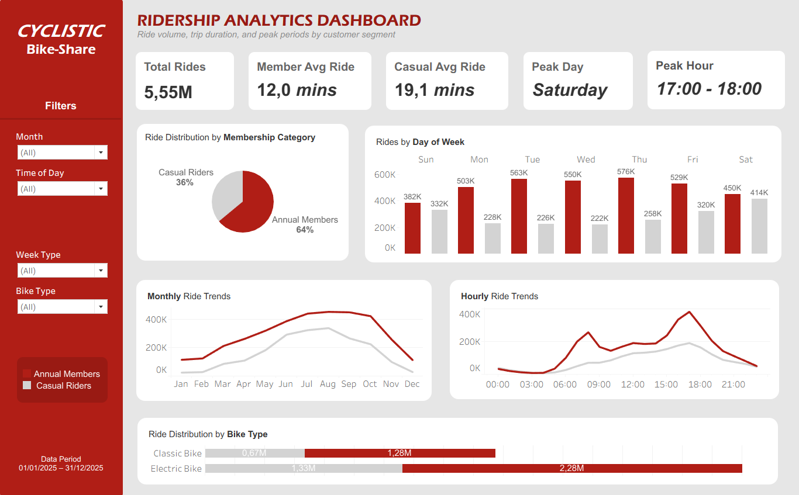

# 🚲 Cyclistic Bike-Share Case Study

**Google Data Analytics Professional Certificate | Capstone Project**

[](https://public.tableau.com/views/CyclisticBike-ShareAnalysisDashboard_17934258541930/CyclisticBike-ShareAnalysisDashboard)

## 📌 Project Overview

An end-to-end analysis of 5.55 million Cyclistic bike-share trips from January to December 2025, examining how annual members and casual riders use the service differently.

Using SQL in Google BigQuery, the project identifies riding patterns and develops three proposed marketing recommendations to support annual membership growth. The results are presented in an interactive Tableau Public dashboard.

The project follows the six-step data analysis process (Ask, Prepare, Process, Analyze, Share, and Act) and is based on Case Study 1, "How does a bike-share navigate speedy success?". Cyclistic is a fictional company, and the analysis uses public Divvy trip data.

## 🎯 Business Task

> 🔎 **Primary question: How do annual members and casual riders use Cyclistic bikes differently?**

The analysis aims to identify differences in riding patterns that can inform strategies to convert casual riders into annual members.

The broader marketing program also asks why casual riders would purchase annual memberships and how digital media can influence them.

## 🗂️ Dataset & Tools

| Detail | Description |
|---|---|
| Data source | Divvy Historical Trip Data |
| Study period | January–December 2025 |
| Trips analyzed | 5,552,912 |
| Tools | Google BigQuery (SQL) and Tableau Public |

## 📊 Dashboard

**[View the interactive Ridership Analytics Dashboard on Tableau Public](https://public.tableau.com/views/CyclisticBike-ShareAnalysisDashboard_17934258541930/CyclisticBike-ShareAnalysisDashboard)**

- **KPIs:** Total Rides, Member Avg Ride, Casual Avg Ride, Peak Day, and Peak Hour.
- **Charts:** Membership distribution, rides by day of week, monthly and hourly trends, and bike type distribution.
- **Filters:** Month, Time of Day, Week Type, and Bike Type.

## 🔍 Key Findings

| Metric | Annual Members | Casual Riders |
|---|---:|---:|
| Share of rides | 63.99% | 36.01% |
| Average trip duration | 11.96 minutes | 19.14 minutes |
| Weekend ride share | 23.43% | 37.31% |
| Highest-volume day | Thursday | Saturday |
| Highest-volume month | August | August |
| Highest-volume hour | 17:00 | 17:00 |
| Electric bike share | 64.11% | 66.36% |

The clearest differences are trip duration and weekly pattern: annual members ride more often and mostly on weekdays, while casual riders take longer trips and a larger share of their rides on weekends.

## 💡 Recommendations

1. **Target weekend casual riders with membership campaigns**
2. **Demonstrate the potential value of annual membership**
3. **Align campaign timing with seasonal and hourly activity patterns**

These are proposed actions to test. Supporting evidence, success measures, and next steps are in [`06_act.md`](documentation/06_act.md).

## 📁 Repository Structure

```
cyclistic-capstone-project/
├── README.md
├── documentation/   # Phase documents and chart images
├── sql/             # 17 numbered BigQuery SQL scripts
└── logs/            # Validation log and evidence screenshots
```

| Phase | Document | Deliverable |
|---|---|---|
| Ask | [`01_ask.md`](documentation/01_ask.md) | Statement of the business task |
| Prepare | [`02_prepare.md`](documentation/02_prepare.md) | Description of data sources |
| Process | [`03_process.md`](documentation/03_process.md) | Documentation of data cleaning and transformation |
| Analyze | [`04_analyze.md`](documentation/04_analyze.md) | Summary of analysis |
| Share | [`05_share.md`](documentation/05_share.md) | Supporting visualizations and key findings |
| Act | [`06_act.md`](documentation/06_act.md) | Top three recommendations |

The validation record is available in [`logs/validation_logs.md`](logs/validation_logs.md).

## 📎 References

- [Divvy System Data](https://divvybikes.com/system-data)
- [Divvy Historical Trip Data](https://divvy-tripdata.s3.amazonaws.com/index.html)
- [Divvy Data License Agreement](https://divvybikes.com/data-license-agreement)

## 👩‍💻 Author

**Dinda Laura** · [LinkedIn](https://www.linkedin.com/in/dindalaura) · [GitHub](https://github.com/dindalauraa)
