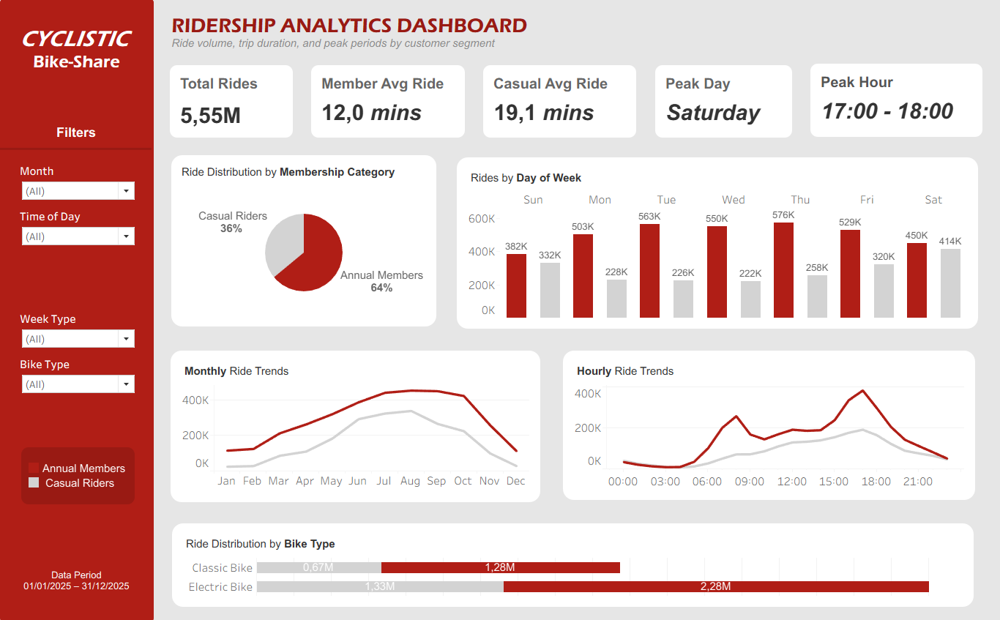
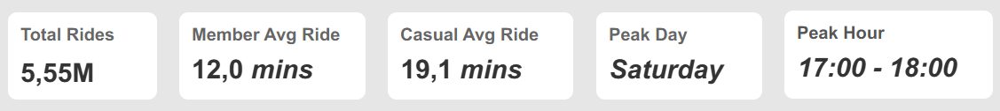
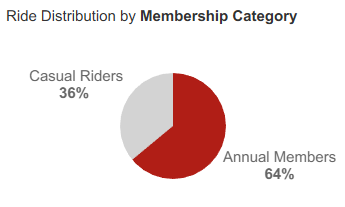
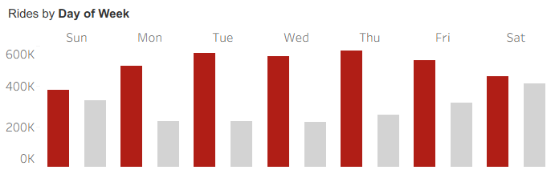
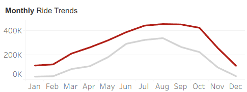
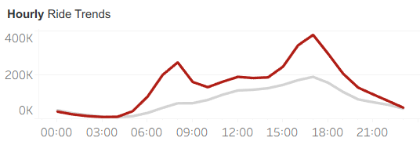
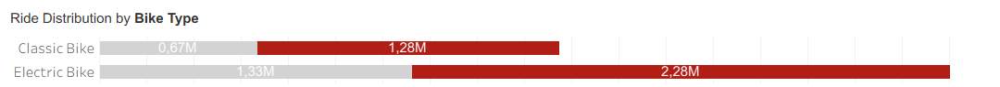

# Cyclistic Bike-Share Case Study

## Share Phase

### 1. Dashboard Overview

The findings from the Analyze phase were communicated through an interactive Tableau Public dashboard titled **Ridership Analytics Dashboard**.

The dashboard compares annual members and casual riders across ride volume, trip duration, and usage patterns to address the primary research question:

**How do annual members and casual riders use Cyclistic bikes differently?**

| Project Detail | Description |
|---|---|
| Platform | Tableau Public |
| Dashboard | [Ridership Analytics Dashboard](https://public.tableau.com/views/CyclisticBike-ShareAnalysisDashboard_17934258541930/CyclisticBike-ShareAnalysisDashboard) |
| Publication date | November 1, 2026 |
| Data source | `cyclistic_2025.dashboard_2025` |
| Dataset size | 8,060 aggregated rows |
| Total trips | 5,552,912 |
| Data period | January 1–December 31, 2025 |
| Intended audience | Marketing Director, Marketing Analytics Team, and Executive Team |

**Dashboard Preview**

*Figure 1. Ridership Analytics Dashboard showing the full-year view with no filters applied.*

### 2. Dashboard Design and Interactivity

#### 2.1 Layout and Visual Hierarchy

The dashboard follows a summary-to-detail structure, allowing users to review the main performance indicators before exploring individual usage patterns.

The layout consists of:

1. Five KPI cards summarizing overall ride activity.
2. Membership distribution and rides by day of week.
3. Monthly and hourly ride trends.
4. Bike type distribution.

A left-hand panel contains the Cyclistic logo, filters, rider-type legend, and data period.

#### 2.2 Color and Comparison

Annual members are represented in dark red, while casual riders are represented in grey.

The same color assignment is maintained across all charts to support consistent comparisons between rider groups.

#### 2.3 Interactive Filters

Four filters allow users to explore different subsets of the dataset.

| Filter | Available Options |
|---|---|
| Month | January–December |
| Time of Day | Morning (05:00–09:59), Midday (10:00–15:59), Evening (16:00–19:59), Night (20:00–04:59) |
| Week Type | Weekday (Monday–Friday), Weekend (Saturday–Sunday) |
| Bike Type | Classic bike, Electric bike |

Rider type is maintained as a permanent comparison through the color legend rather than an interactive filter. This keeps both groups visible across the dashboard.

#### 2.4 Metric Definitions

| Metric | Definition |
|---|---|
| Total Rides | Sum of ride counts under the selected filters |
| Member Avg Ride | Eligible member ride duration divided by eligible member rides, in minutes |
| Casual Avg Ride | Eligible casual ride duration divided by eligible casual rides, in minutes |
| Peak Day | Day with the highest combined ride count |
| Peak Hour | Starting hour with the highest combined ride count |

Average ride duration includes trips lasting at least one second and no more than 24 hours. Trips outside this range remain included in ride counts.

The findings in Section 3 represent the full-year view with no filters applied. Applying filters updates the dashboard metrics and charts without changing the full-year figures documented below.

### 3. Dashboard Findings

#### 3.1 KPI Cards

The KPI cards summarize overall ride volume, average trip duration, and peak usage periods.

*Figure 2. Five KPI cards summarizing overall ride activity and duration.*

| KPI | Value |
|---|---:|
| Total Rides | 5.55M |
| Member Avg Ride | 12.0 minutes |
| Casual Avg Ride | 19.1 minutes |
| Peak Day | Saturday |
| Peak Hour | 17:00–18:00 |

Casual riders recorded an average trip approximately 60% longer than annual members.

Saturday had the highest combined ride volume, with 864,405 rides, narrowly ahead of Friday with 849,066 rides. The highest combined hourly volume occurred at 17:00, with 572,442 rides.

Peak Day and Peak Hour represent combined ride counts from both rider groups.

#### 3.2 Ride Distribution by Membership Category

The membership distribution chart compares the proportion of total rides contributed by each rider group.

*Figure 3. Ride distribution by membership category.*

| Rider Type | Total Rides | Share |
|---|---:|---:|
| Annual members | 3,553,461 | 63.99% |
| Casual riders | 1,999,451 | 36.01% |

Annual members accounted for nearly two-thirds of total rides. Casual riders contributed more than one-third, representing a substantial share of overall service usage.

#### 3.3 Rides by Day of Week

The day-of-week chart compares ride volume across the seven days for both rider groups.

*Figure 4. Ride volume by day of week and rider type.*

- Annual members recorded their highest daily volume on Thursday, with 576,005 rides.
- Casual riders peaked on Saturday, with 414,206 rides.
- Weekend rides represented 37.31% of casual rides, compared with 23.43% of member rides.
- Saturday recorded the highest combined daily volume, with 864,405 rides.

The results show a clear difference in weekly usage patterns. Annual members had a greater concentration of rides on weekdays, while casual riders contributed a larger proportion of weekend activity.

#### 3.4 Monthly Ride Trends

The monthly trend chart compares ride volume from January to December 2025.

*Figure 5. Monthly ride trends by rider type.*

- Both rider groups recorded their highest monthly volume in August.
- Casual riders recorded 337,878 rides in August, compared with 452,439 rides among annual members.
- January was the lowest-volume month for casual riders, with 24,124 rides.
- December was the lowest-volume month for annual members, with 112,447 rides.
- Casual riders recorded their highest monthly share in June, accounting for 43.02% of rides.

Both groups experienced higher ride volumes during the middle of the year. However, casual riders showed greater variation across the observed months.

These findings describe the 2025 data period and should not be interpreted as evidence of long-term seasonal trends.

#### 3.5 Hourly Ride Trends

The hourly trend chart compares ride volume by trip starting hour for annual members and casual riders.

*Figure 6. Hourly ride trends by rider type.*

- Both groups recorded their highest hourly volume at 17:00.
- Annual members recorded 381,788 rides at 17:00, while casual riders recorded 190,654 rides.
- Annual members showed additional increases around 07:00–09:00 and 16:00–18:00.
- Casual riders recorded relatively high volumes from 12:00 to 18:00.

Annual members displayed more pronounced morning and afternoon peaks, while casual riders showed a broader afternoon concentration.

These patterns describe trip starting times and do not establish the purposes of individual trips.

#### 3.6 Ride Distribution by Bike Type

The bike type chart compares classic and electric bike usage across both rider groups.

*Figure 7. Bike type distribution by rider type.*

| Rider Type | Electric Bike | Classic Bike |
|---|---:|---:|
| Casual riders | 66.36% | 33.64% |
| Annual members | 64.11% | 35.89% |

Electric bikes accounted for the majority of rides in both groups.

The difference in electric bike usage was 2.25 percentage points, indicating a similar distribution across the two rider groups. Bike type therefore showed less variation between groups than trip duration and weekly usage patterns.

### 4. Summary of Findings

| Dimension | Annual Members | Casual Riders |
|---|---:|---:|
| Share of rides | 63.99% | 36.01% |
| Average trip duration | 11.96 minutes | 19.14 minutes |
| Median trip duration | 8.58 minutes | 11.38 minutes |
| Weekend ride share | 23.43% | 37.31% |
| Highest-volume day | Thursday | Saturday |
| Highest-volume month | August | August |
| Highest-volume hour | 17:00 | 17:00 |
| Electric bike share | 64.11% | 66.36% |

The clearest differences were observed in trip duration and weekly usage patterns. Annual members accounted for more rides and had a greater concentration of weekday activity. Casual riders generally took longer trips and contributed a larger share of weekend rides.

Both groups showed similar monthly and hourly peaks, as well as comparable bike type distributions.

These findings address the primary research question for the 2025 data period. They describe observed usage patterns without establishing rider motivations or the effectiveness of any membership conversion strategy.

### 5. Interpretation and Accessibility Notes

- Rider groups use consistent colors across all charts, supported by a permanent legend.
- Key findings and numerical values are also presented in text and tables to support interpretation beyond the visualizations.
- The dashboard was designed for desktop viewing at 1366 × 850.
- Duration statistics exclude trips under one second and over 24 hours, while these trips remain included in ride counts.
- Monthly patterns cover 2025 only and do not establish long-term seasonal trends.
- Day-of-week and starting-hour patterns cannot independently confirm trip purpose.
- The analysis is descriptive and does not establish statistical significance or causal relationships.

### 6. Share Deliverables

| Deliverable | Location |
|---|---|
| Published dashboard | [Ridership Analytics Dashboard](https://public.tableau.com/views/CyclisticBike-ShareAnalysisDashboard_17934258541930/CyclisticBike-ShareAnalysisDashboard) |
| Dashboard dataset | `cyclistic_2025.dashboard_2025` |
| Final dashboard screenshot | `logs/screenshots/31_tableau_dashboard_final.png` |
| Chart images | `documentation/images/` |
| Dashboard validation | `logs/validation_logs.md`, Section 7 |
| Supporting SQL scripts | `sql/` |

The dashboard KPIs were cross-validated against BigQuery results, including total ride volume, rider distribution, average duration, Peak Day, and Peak Hour. The validation activities and supporting evidence are documented in `logs/validation_logs.md`.

**Share Outcome:** The analysis findings were communicated through an interactive Tableau Public dashboard, presenting the differences between annual members and casual riders across ride volume, trip duration, weekly patterns, monthly trends, hourly activity, and bike type usage.
